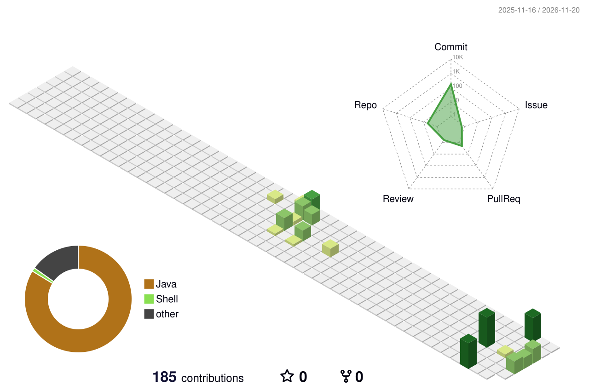

  <a href="https://git.io/typing-svg">
    <picture>
      <source media="(prefers-color-scheme: dark)" srcset="https://readme-typing-svg.herokuapp.com?font=JetBrains+Mono&weight=600&size=19&duration=3200&pause=1200&color=E6EDF3&center=true&vCenter=true&width=600&lines=Hi%2C+I'm+SuRanHF;AI+Agent+(DSH+%C2%B7+MCP)+%C2%B7+LumiIris+%E7%92%83%E7%9E%B3;%E7%94%A8%E4%BB%A3%E7%A0%81%E6%8A%8A%E6%83%B3%E6%B3%95%E5%81%9A%E5%87%BA%E6%9D%A5" />
      <source media="(prefers-color-scheme: light)" srcset="https://readme-typing-svg.herokuapp.com?font=JetBrains+Mono&weight=600&size=19&duration=3200&pause=1200&color=1F2328&center=true&vCenter=true&width=600&lines=Hi%2C+I'm+SuRanHF;AI+Agent+(DSH+%C2%B7+MCP)+%C2%B7+LumiIris+%E7%92%83%E7%9E%B3;%E7%94%A8%E4%BB%A3%E7%A0%81%E6%8A%8A%E6%83%B3%E6%B3%95%E5%81%9A%E5%87%BA%E6%9D%A5" />
      
    </picture>
  </a>

 

<table>
  <tr>
    <td width="74%" valign="top">
      <h3>SuRanHF</h3>
      

        <strong>AI Agent 插件 · 璃瞳 LumiIris 独立开发者</strong>
      

      

        主要折腾两件事：给 AI Agent 写好用的本地桥梁与工具生态（DeepSeek Harness / MCP），以及打磨自己想用的跨端软件（LumiIris 璃瞳）。日常也写 Java / Android、Python、深度学习和 C/C++。
      

      

        这里放的项目没有多余装饰，能跑起来、自己天天在用就是标准。
      

      

        <a href="https://github.com/SuRanHF">GitHub</a> ·
        <a href="https://github.com/SuRanHF?tab=repositories">Repositories</a> ·
        <a href="https://github.com/SuRanHF?tab=stars">Stars</a>
      

    </td>
    <td width="26%" align="right" valign="top">
      
    </td>
  </tr>
</table>

## 正在做

- **[dsh-gui-turn](https://github.com/SuRanHF/dsh-gui-turn)** — DeepSeek Harness 桌面端的本地回环 HTTP 桥接插件。支持外部进程按轮次触发完整 Agent 执行，独立配置人设、挂载 MCP 服务与 fail-closed 工具白名单。
- **[LumiIris Studio（璃瞳）](https://github.com/SuRanHF/lumiiris-releases)** — 桌面端与移动端架构严格隔离的独立软件发行体系与自动更新通道。

## 代表作

| 项目 | 一句话 | 方向 | 入口 |
| :--- | :--- | :--- | :--- |
| **dsh-gui-turn** | 通过本地回环 HTTP 从任意进程触发 DSH Agent 轮次 | AI Agent / MCP | [查看 ↗](https://github.com/SuRanHF/dsh-gui-turn) |
| **lumiiris-releases** | LumiIris Studio（璃瞳）正式版发行与自动更新清单 | Release / Mobile | [查看 ↗](https://github.com/SuRanHF/lumiiris-releases) |
| **lumiiris-desktop-releases** | 璃瞳桌面端独立发行仓库（与移动端隔离） | Desktop | [查看 ↗](https://github.com/SuRanHF/lumiiris-desktop-releases) |

## 更多

<strong>技术栈与其他仓库</strong>

 

- **AI Agent & 客户端**：JavaScript · Electron · Cordis · MCP · HTTP API · Java · Android / LSPosed
- **机器学习 & 通用开发**：Python 3.12 · PyTorch · TensorFlow · Scikit-Learn · OpenCV · Django · PyQt · C / C++ · Bash
- **数据 & 工程基建**：Docker · PostgreSQL · MySQL · SQLite · Git / GitHub Actions
- **其他仓库**：[lumiiris-test-releases](https://github.com/SuRanHF/lumiiris-test-releases)（璃瞳 Beta 内测通道）· [LSPosed](https://github.com/SuRanHF/LSPosed)（Android 框架生态）

<strong>开源贡献轨迹（自动更新）</strong>

 

<picture>
  <source media="(prefers-color-scheme: dark)" srcset="https://raw.githubusercontent.com/SuRanHF/SuRanHF/output/github-contribution-grid-snake-dark.svg" />
  <source media="(prefers-color-scheme: light)" srcset="https://raw.githubusercontent.com/SuRanHF/SuRanHF/output/github-contribution-grid-snake.svg" />
  
</picture>

  

---

SuRanHF · Code &amp; Anime
